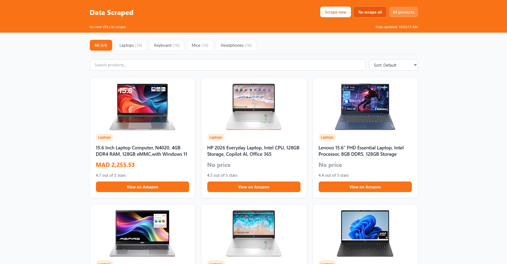
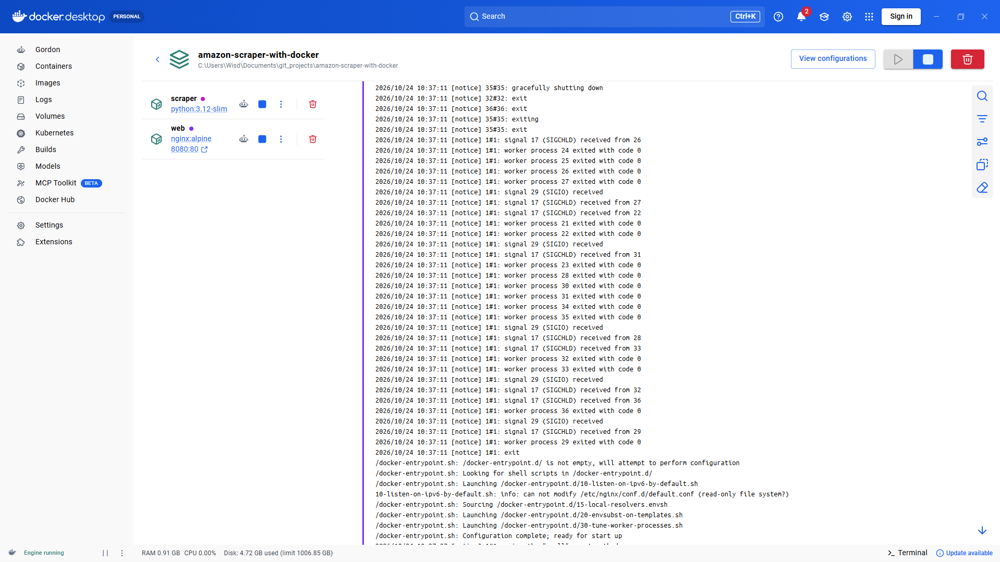
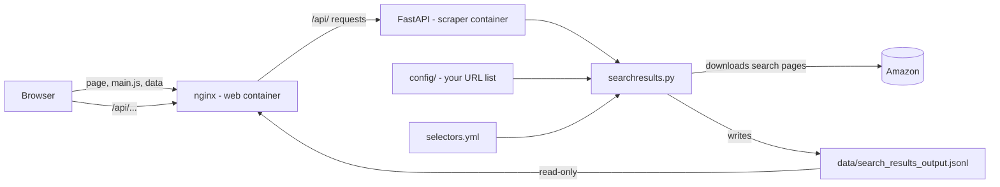

# Amazon Scraper with Docker

A small project that collects products from Amazon search pages and shows them on a simple web page.

You write a list of searches (for example "laptops"). The scraper opens each search page, saves the products, and the web page shows them in tabs, one tab for each category.

Everything runs with one command: `docker compose up -d`.

> This project is based on the [Amazon scraper by ScrapeHero](https://github.com/scrapehero-code/amazon-scraper). It uses Python Requests and Selectorlib. We added Docker, an API, and a web page.

---

## Features

- **One command to start.** Docker runs the scraper and the web page for you.
- **Categories as tabs.** Each search in your list has a category (like "Laptops"). Each category gets its own tab on the page.
- **Scrape new.** Scrapes only the new searches you added. Old products stay.
- **Re-scrape all.** Scrapes every search again. If Amazon blocks one search, its old products stay.
- **Auto check on page load.** When you open or refresh the page, it checks for new searches in the background.
- **Search and sort.** Search by title. Sort by price, rating, or number of reviews.
- **Loading look.** Gray placeholder cards show while data loads. Images fade in when ready.
- **Safe saving.** Data is written to a temporary file first, so the page never reads a half-written file.
- **Easy settings.** Change your list of searches in a file. No rebuild needed.

---

## Screens
Web page: from http://localhost:8080/index.html:



Docker Containers:



## Architecture



There are two containers:

| Container | What it does |
|-----------|--------------|
| **web** (nginx) | Serves `index.html`, `main.js`, and the data file. It sends every `/api/` request to the scraper. |
| **scraper** (FastAPI) | Waits for a request, runs the scraper in the background, and tells the page when it is done. |

The two containers share the `data/` folder. The scraper writes to it. The web container only reads from it.

### What happens when you click "Scrape new"

1. The page sends `POST /api/scrape?mode=new`.
2. The API starts the scrape in the background and answers right away.
3. The scraper reads your list of searches and finds the ones not saved yet.
4. It downloads each new search page from Amazon and pulls out the products.
5. It saves everything to `data/search_results_output.jsonl`.
6. Meanwhile the page asks `GET /api/status` every 2 seconds.
7. When the status says "done", the page loads the new data and shows the cards.

### Files in this project

```
amazon-scraper-with-docker/
├── api.py               # FastAPI app: the two API endpoints
├── searchresults.py     # The scraping code
├── selectors.yml        # Where to find title, price, rating... on the Amazon page
├── docker-compose.yml   # Starts the scraper and the web server
├── nginx.conf           # Web server settings (and the /api/ forward)
├── config/              # Your settings: the list of searches
├── data/                # Saved results (created by the scraper)
├── web/                 # The web page: index.html and main.js
├── src/                 # Python source code
├── pyproject.toml       # Python project settings (uv)
├── uv.lock              # Locked package versions (uv)
├── requirements.txt     # Package list
└── README.md            # This file
```

---

## How to run

You need [Docker Desktop](https://www.docker.com/products/docker-desktop/). Make sure it is running before you start.

1. Open a terminal in the project folder.
2. Start everything:

   ```
   docker compose up -d
   ```

3. Wait about 30 seconds the first time. The scraper installs its packages.
4. Open **http://localhost:8080/index.html**.

Useful commands:

| Command | What it does |
|---------|--------------|
| `docker compose logs -f scraper` | Watch what the scraper is doing |
| `docker compose restart scraper` | Restart the scraper after you change a `.py` file |
| `docker compose down` | Stop everything |

If you change `index.html` or `main.js`, just refresh the browser.

---

## How to add searches

Your list of searches is a JSON file in the `config/` folder, named `search_results_urls.json`. Each item has a category and a URL:

```json
[
  {
    "category": "Laptops",
    "url": "https://www.amazon.com/s?k=laptops"
  },
  {
    "category": "Tablets",
    "url": "https://www.amazon.com/s?k=tablets"
  }
]
```

To add a new search:

1. Add a new item to the file and save it.
2. Refresh the page, or click **Scrape new**.
3. A new tab appears for the new category.

Notes:

- Only the first page of each search is scraped.
- If you rename a category in the file, the tab is renamed on the next scrape.
- If you delete a search from the file, its products are removed the next time you click **Re-scrape all**. **Scrape new** never removes products.

---

## API

The page uses these two endpoints. You can also call them yourself.

| Method | Path | What it does |
|--------|------|--------------|
| `POST` | `/api/scrape?mode=new` | Scrape only searches that are not saved yet |
| `POST` | `/api/scrape?mode=all` | Scrape every search again (you must wait 60 seconds between two of these) |
| `GET` | `/api/status` | Says if a scrape is running, and the last message |

---

## Data format

Each line of `data/search_results_output.jsonl` is one product (JSON Lines format):

```json
{
  "title": "Dell Inspiron 15.6\" Laptop - Intel i3 - 8GB RAM - 128GB SSD",
  "url": "/Dell-Inspiron-Laptop/dp/B08173ZTJX/ref=sr_1_3",
  "image": "https://m.media-amazon.com/images/I/example.jpg",
  "rating": "4.1 out of 5 stars",
  "reviews": "(122)",
  "price": "$472.00",
  "category": "Laptops",
  "search_url": "https://www.amazon.com/s?k=laptops"
}
```

| Field | Meaning |
|-------|---------|
| `title`, `url`, `image`, `rating`, `reviews`, `price` | Pulled from the Amazon page using `selectors.yml` |
| `category` | From your list of searches |
| `search_url` | The search page the product came from |

---


## Good to know

- Amazon changes its pages often. If the scraper stops finding products, the selectors in `selectors.yml` probably need an update.
- Amazon may block a lot of fast requests from one computer. The scraper waits 3 seconds between searches to be gentle.
- Read and follow Amazon's rules about automated access before you use this on a large scale.


Built with ❤️ by the community, from [scrapehero-code/amazon-scraper](https://github.com/scrapehero-code/amazon-scraper).